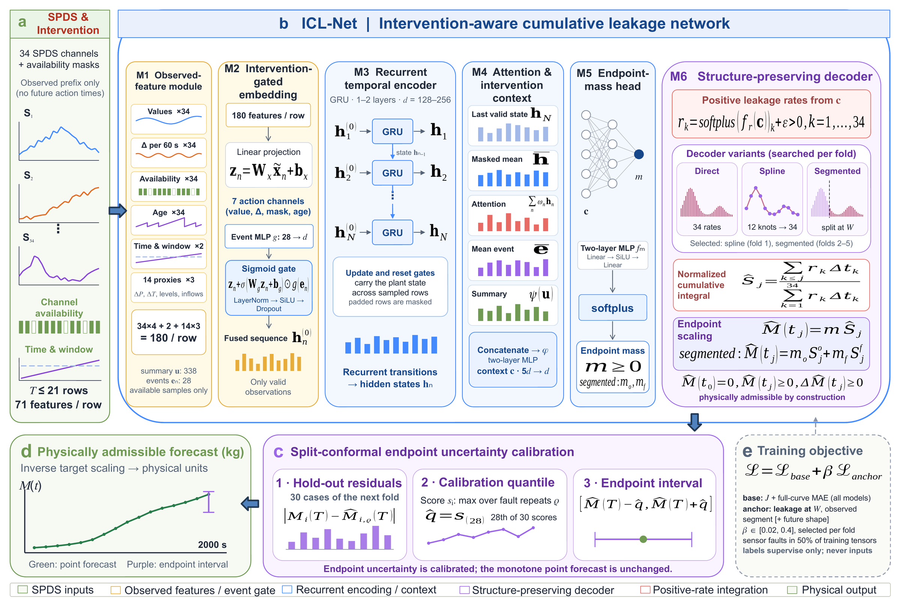
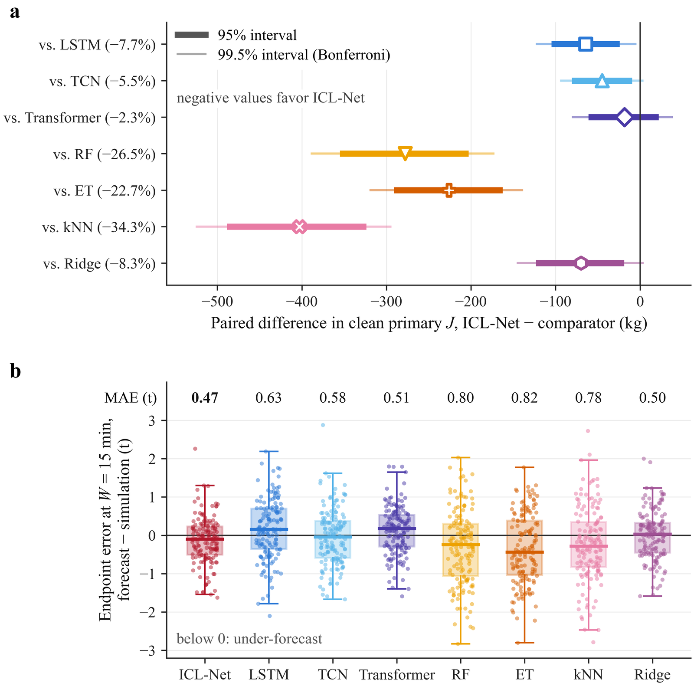
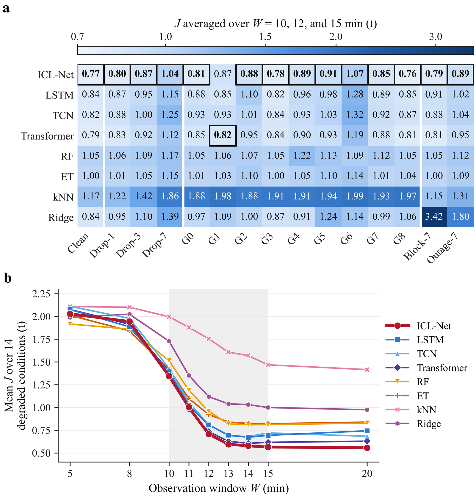
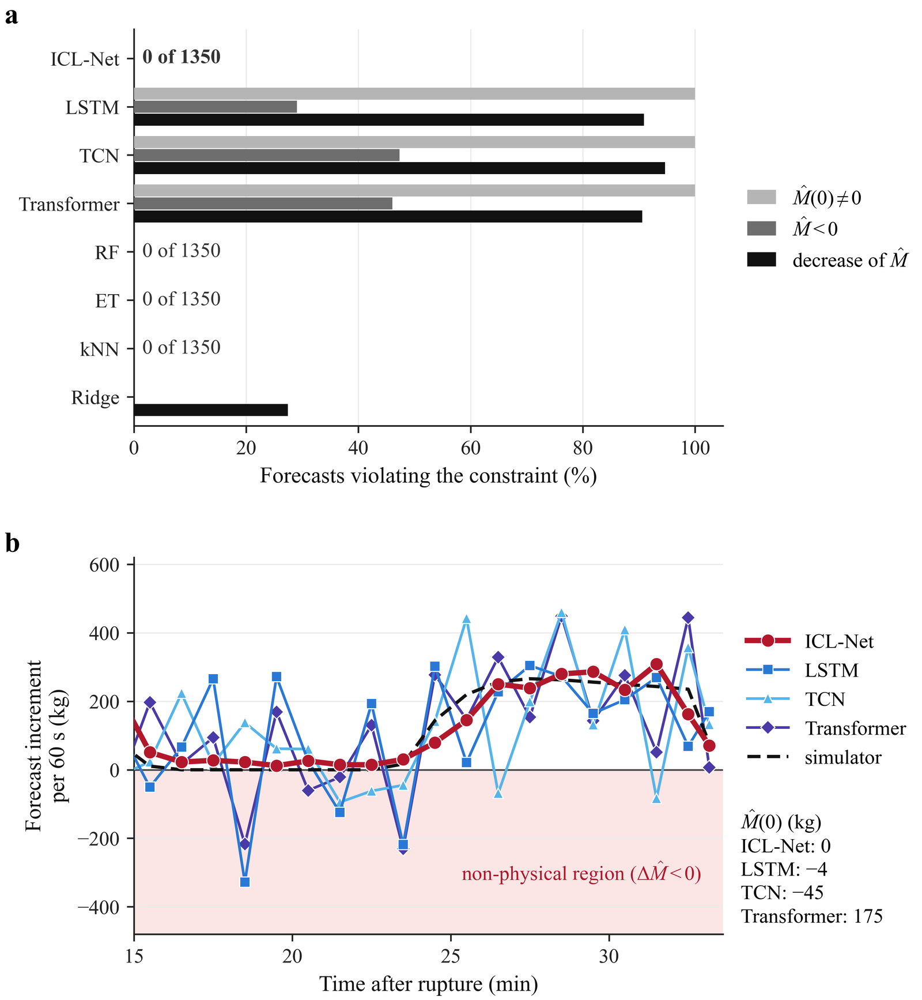

# ICL-Net

**Intervention-aware and physically admissible leakage forecasting for nuclear accident management**

Wen Zhou, Shuichiro Miwa, Kenji Aragane, Takumi Kitao, Masaaki Mori, Ruicong Xu, Hanyu Wang, Yangkai Huang, Yosuke Nishimura, Ravinder Kumar, Ryo Yokoyama, Shunichi Suzuki, Koji Okamoto

**Online demo:** <https://park-syndicate-evaluation-teeth.trycloudflare.com>

## Overview

Steam generator tube rupture (SGTR) dominates the risk of many nuclear reactors because primary coolant can bypass the containment. Its leakage depends on operator actions that are still pending when protective decisions are made, yet reported forecasters predict instantaneous variables from complete sensor sets with unconstrained outputs. ICL-Net, an intervention-aware cumulative leakage network, forecasts the cumulative primary-to-secondary leakage up to 2000 s from the first 5–20 min of 34 plant (SPDS) signals. It gates operator-action signals into a recurrent encoder and integrates positive rates, so every forecast starts at zero and never decreases. ICL-Net and seven deep and classical comparators were evaluated on 150 simulated transients of a four-loop plant under 15 sensor conditions. ICL-Net achieved the lowest composite endpoint-and-trajectory error, 2.3–34.3 % below the comparators with complete signals and 4.7–49.9 % below them under sensor loss, and its split-conformal intervals reached an aggregate coverage of 91.3 % at a nominal 90 %.

<p align="center"></p>

## Highlights

- **Missing-data aware.** An observed-feature module gives every signal and 14 physics-motivated proxies availability flags and ages, so missing channels are not mistaken for low readings.
- **Intervention-aware.** An event pathway gates the reactor-trip, safety-injection and valve signals of protection and operator actions into a GRU encoder; no future action time is ever an input.
- **Physically admissible by design.** A structure-preserving decoder multiplies the endpoint leakage by a normalized integral of positive rates, so *M*(0) = 0, *M* ≥ 0 and *M* never decreases.
- **State-anchored training.** An auxiliary loss supervises the leakage already accumulated in the observed window, and missingness augmentation exposes the network to sensor loss.
- **Calibrated uncertainty.** Split conformal prediction turns every forecast into a 90 % endpoint interval whose width falls by 69 % once the intact-SG cooldown is observed.
- **Decision support.** Required and earliest acceptable observation windows tell emergency planners when an early forecast becomes usable.

## Key Results

<p align="center"></p>

**Complete signals.** ICL-Net had the lowest primary *J* of the eight models, 2.3–34.3 % below the comparators, and an endpoint MAE of 0.47 t (1.37 % MAPE) at *W* = 15 min.

<p align="center"></p>

**Sensor loss.** Over 14 degraded sensor conditions, ICL-Net's primary *J* was 4.7–49.9 % below the comparators, and it met a 2 % endpoint MAPE within 13 min in 13 of 15 sensor conditions, two more than any comparator.

<p align="center"></p>

**Physical admissibility.** All 1350 clean ICL-Net forecasts started at zero, stayed non-negative and never decreased, whereas every clean forecast of the three deep comparators violated at least one of these constraints.

## Online Demo

The web demonstrator at <https://park-syndicate-evaluation-teeth.trycloudflare.com> applies the released models to observation windows entered in the browser. Enter one window, or upload a CSV of many windows in the format of [data/README.md](data/README.md) (a template can be downloaded from the page). Each window receives the 35-point forecast from 0 to 2000 s and a 90 % endpoint interval, and batch results can be downloaded as `prediction_results.csv`. The page also summarizes the results of the paper.

## Repository Structure

```
ICL-Net_release/
├── data/README.md      data availability, dataset description and input format
├── scripts/train.py    complete training: data pipeline, model, loss, optional search, conformal calibration
├── scripts/test.py     reproduction of the paper's results and inference on new observation windows
├── models/             final ICL-Net (5 folds × 3 seeds), input scalers and conformal radii (config.json)
├── figures/            figures shown in this README
└── requirements.txt
```

## Usage

```bash
pip install -r requirements.txt
```

### Training

```bash
python scripts/train.py            # selected hyperparameters of the paper, about 30 min on one GPU
python scripts/train.py --search   # first re-run the 48-trial hyperparameter search of every fold
```

Training needs the dataset in `data/raw/` (see [data/README.md](data/README.md)). It fits three seeds per fold on the fold's 90 training and validation transients, calibrates the conformal radii on the 30 calibration transients, and writes `outputs/models/` in the same format as `models/`.

### Testing

```bash
python scripts/test.py                             # reproduce the paper's results with models/
python scripts/test.py --models outputs/models     # evaluate retrained models
python scripts/test.py --input windows.csv         # forecast new observation windows
```

The evaluation predicts every test and calibration transient under the 15 sensor conditions and 9 observation windows (about 1 min on one GPU), recomputes the conformal radii, and reports the paper's primary results:

```
                                                        reproduced         paper
  Clean signals: primary J, W = 10/12/15 min (kg)           770.72        770.72
  Clean signals: endpoint MAE at W = 15 min (kg)            472.08        472.08
  Clean signals: endpoint MAPE at W = 15 min (%)             1.375         1.375
  Sensor loss: primary J, 14 conditions (kg)                872.36        872.36
  Physically inadmissible clean forecasts                        0             0
  Cooldown-timing pair error (kg)                          1268.45       1268.45
  Interval coverage, nominal 90% (%)                         91.31         91.31
  Mean 90% interval width (kg)                             5317.52       5317.52
  Conditions accepted within 2 t (W* found)                     12            12
```

Without the dataset, `--input` applies the released models to any CSV of observation windows in the format of [data/README.md](data/README.md). Each window receives the mean forecast of the five fold ensembles at 35 times from 0 to 2000 s and a 90 % endpoint interval, written to `outputs/prediction_results.csv`.

The results were produced with Python 3.12, PyTorch 2.8.0 (CUDA 12.6) and an NVIDIA RTX A6000. With this software stack, `train.py` regenerates the released weights bit for bit and `test.py` reproduces the reported values to machine precision; other hardware or library versions give differences at floating-point level.

## Data Availability

The dataset is not publicly released due to data confidentiality or usage restrictions. It may be made available upon reasonable request, subject to applicable permissions and agreements. See [data/README.md](data/README.md).
